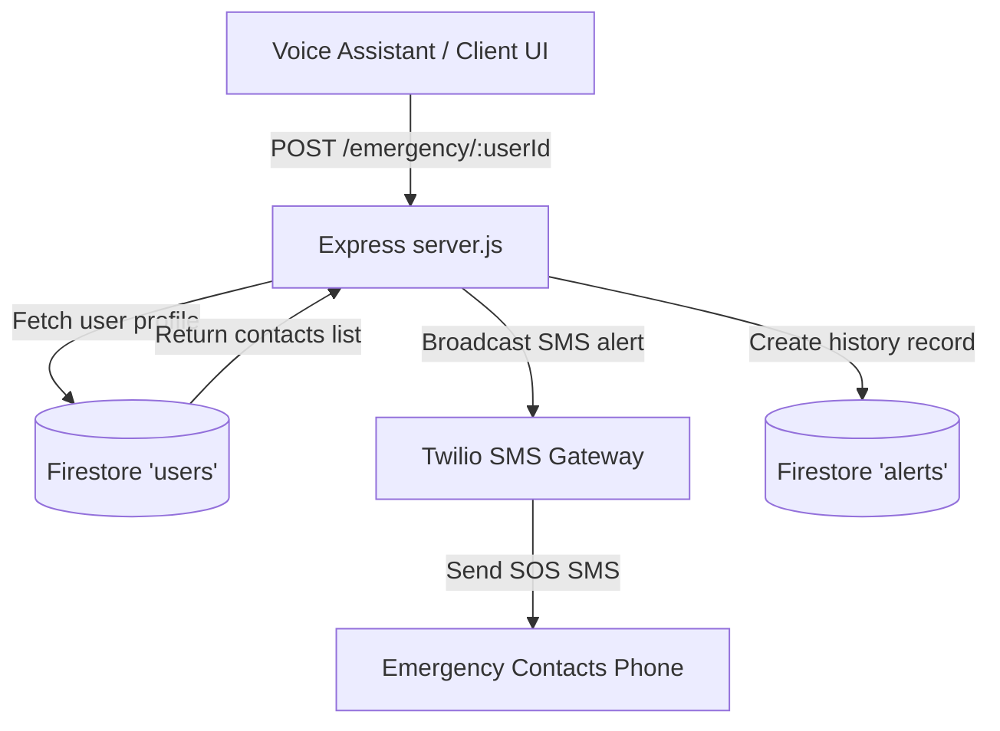
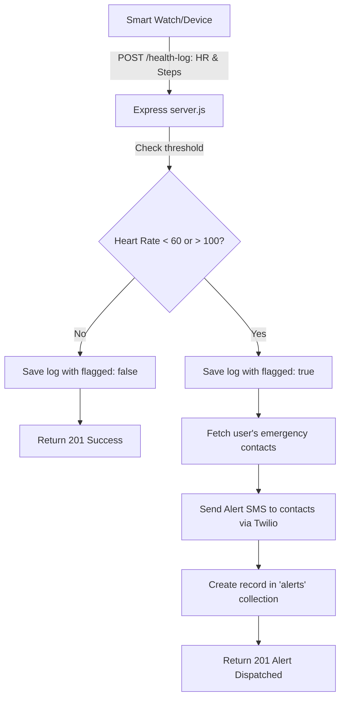

# AI Digital Personal Assistant for Elderly - Backend

Welcome to the backend server for the **AI Digital Personal Assistant for Elderly**! This server is built using **Node.js** and **Express**, with **Firebase Firestore** as the database, **Twilio** for emergency SMS alerts, and **node-cron** for background tasks (medicine schedules and daily refreshes).

This API is designed to be consumed by a separate **voice assistant module** and a **frontend user interface (website/app)**.

---

## 📂 Project Folder Structure

This project follows a clean **MVC (Model-View-Controller)** inspired backend architecture to keep concerns separate and the codebase maintainable:

```
backend/
├── src/
│   ├── config/          # Service configurations (Firebase DB & Twilio SMS)
│   │   ├── firebase.js  # Firebase Admin SDK initialization & DB connection helper
│   │   └── twilio.js    # Twilio SMS initialization with Twilio configuration and send results
│   ├── controllers/     # Business logic per feature (contains logic for requests/responses)
│   │   ├── userController.js         # User registration & profile retrieval
│   │   ├── medicineController.js     # Adding schedules, getting schedules & updates
│   │   ├── appointmentController.js  # Doctor appointment bookings & listings
│   │   └── healthController.js       # Health logging, anomaly checks & SOS panic trigger
│   ├── routes/          # Express route definitions mapping URLs to controllers
│   │   └── api.js       # Root routing configuration for exact endpoints
│   ├── jobs/            # Scheduled background worker tasks
│   │   └── reminderJob.js  # Minutely due/overdue checker & Daily midnight state reset
│   └── server.js        # The app entry point (middleware binding, database startup, server run)
├── .env.example         # Template environment variables (no real credentials/secrets)
├── .gitignore           # List of directories/files to ignore in version control (e.g., node_modules, .env)
├── package.json         # Project metadata, dev scripts, and package dependencies
└── README.md            # You are here! Complete documentation and project setup guide
```

---

## 🛠️ Step-by-Step Installation & Setup

Follow these steps to run the server on your local machine:

### 1. Prerequisites
Make sure you have [Node.js](https://nodejs.org/) installed (v14 or higher recommended).

### 2. Clone and Install Dependencies
Navigate to the `backend` directory and install the necessary npm packages:
```bash
# Go to backend directory
cd backend

# Install dependencies
npm install
```

### 3. Setup Environment Variables (`.env`)
Create a file named `.env` in the root of the `backend` directory. Use the template in `.env.example` as a reference:
```bash
# Copy example env to a local dotenv file
cp .env.example .env
```
Fill in the values inside `.env` as explained below.

#### How to acquire credentials:
* **`PORT`**: Set it to your desired port number (e.g., `5000`).
* **Firebase Credentials (`FIREBASE_*`)**:
  1. Open the [Firebase Console](https://console.firebase.google.com/).
  2. Create a new project (e.g. "Elderly Personal Assistant").
  3. Go to **Project Settings** (gear icon) > **Service Accounts**.
  4. Select **Node.js** and click **Generate new private key**. This downloads a JSON file.
  5. Open the JSON file and extract the variables:
     * `project_id` ➔ Copy into `FIREBASE_PROJECT_ID`
     * `client_email` ➔ Copy into `FIREBASE_CLIENT_EMAIL`
     * `private_key` ➔ Copy into `FIREBASE_PRIVATE_KEY` (make sure to replace real newlines with `\n` in a single line inside quotes).
* **Twilio Credentials (`TWILIO_*`)**:
  1. Sign up for a free developer account at [Twilio](https://www.twilio.com/).
  2. Go to the Twilio Console Dashboard.
  3. Copy your **Account SID** and **Auth Token** into `TWILIO_ACCOUNT_SID` and `TWILIO_AUTH_TOKEN`.
  4. Buy a **Twilio Phone Number** (it is free for trial accounts) and copy it into `TWILIO_PHONE_NUMBER`.
* **`MEDICINE_GRACE_PERIOD_MIN`**: The number of minutes before a pending medicine is marked as "missed" (default is `30`).

> [!NOTE]
> **Twilio delivery status:**
> Without valid credentials, the server stays available but SMS sends return a failure state; messages are not printed or reported as delivered.

---

## 🚀 Running the Server

To start the server, you have two commands available in your package scripts:

* **Development Mode** (auto-restarts when files change using `nodemon`):
  ```bash
  npm run dev
  ```
* **Production Mode** (standard execution):
  ```bash
  npm start
  ```

* **Read-only Firestore connectivity diagnostic** (checks configuration without printing credentials or document data):
  ```bash
  npm run diagnose:firestore
  ```
  The check reads at most one document from `users` and reports only the document count or a redacted Firestore error. If a system proxy is interfering, configure `FIRESTORE_NO_PROXY_HOSTS=firestore.googleapis.com` and `GOOGLE_API_NO_PROXY_HOSTS=googleapis.com` in `.env`.

---

## 📊 Database Collections (Firestore Schema)

The server stores and updates the following collections in Firebase Firestore:

| Collection | Schema / Fields | Description |
| :--- | :--- | :--- |
| **`users`** | `userId`, `name`, `age`, `phone`, `emergencyContacts[]` | Stores user profiles. `emergencyContacts` contains objects with `{ name, relation, phone }`. |
| **`medicines`** | `medId`, `userId`, `medicineName`, `dosage`, `time`, `frequency`, `status` | Stores medicine schedules. `status` can be `"pending"`, `"taken"`, or `"missed"`. |
| **`medicine_doses`** | `doseId`, `userId`, `medId`, `medicineName`, `dosage`, `scheduledTime`, `scheduledDate`, `status`, `updatedAt` | Stores per-day completed dose history separately from recurring schedules. |
| **`appointments`** | `apptId`, `userId`, `doctorName`, `date`, `time`, `location`, `reminderSent` | Stores upcoming doctor consultations. |
| **`healthLogs`** | `logId`, `userId`, `heartRate`, `steps`, `timestamp`, `flagged` | Health tracks. `flagged` becomes `true` if heartRate falls outside 60-100 bpm. |
| **`alerts`** | `alertId`, `userId`, `type`, `timestamp`, `notifiedContacts[]` | Stores history of all SOS triggers, medicine misses, or health alarms. |
| **`notificationAccess`** | `email`, `emailHash`, `patientId`, `role`, `status`, `authUid` | Server-managed grants connecting verified email-link identities to a patient profile or an invited family relationship. Existing `users` documents are not modified. |
| **`notificationInvitations`** | `emailHash`, `patientId`, `displayName`, `status`, `expiresAt`, `acceptedByUid` | Server-managed, hashed, single-use family invitations. The raw invitation code is sent only in the verified email link and expires after seven days. |
| **`notificationTokens`** | `token`, `principalUid`, `patientIds[]`, `preferences`, `platform`, `createdAt`, `updatedAt` | Server-managed FCM web registrations. Registration and delivery require a verified Firebase ID token and a current `notificationAccess` grant. |

## Web Push Notification Setup

The existing Carewise profile-ID/phone lookup remains the dashboard login, but it is not used as proof of identity for push registration. Notification access uses Firebase Authentication email-link sign-in; SMS and Phone Authentication are not used by this flow.

Before enabling it, enable **Email/Password** and **Email link (passwordless sign-in)** in Firebase Authentication, and authorize the app's actual development/deployment hostname. The frontend already has the public Firebase web config, VAPID public key, service worker, and user-initiated browser permission flow. Deployed sites must use HTTPS; `localhost` is suitable for local development.

Each existing patient needs a one-time access grant provisioned only after an operator confirms that the email belongs to that patient. This is needed because the existing local Profile ID/phone login does not prove ownership of a profile to Firebase Authentication. The script checks the existing profile and performs a dry run unless `--apply` is supplied:

```bash
cd backend
node src/scripts/provisionNotificationAccess.js <existing-profile-id> <verified-email>
node src/scripts/provisionNotificationAccess.js <existing-profile-id> <verified-email> --apply
```

The grant is written to `notificationAccess`; the script does not alter `users`. Once a patient has a verified notification identity, they can invite a family member by name and email from the dashboard. The family member signs in with the invited verified email and explicitly accepts a single-use invitation that expires after seven days. Patients can review and revoke pending or accepted invitations. Family members see their authorized profiles and profile-scoped alert history on the Browser Notifications page. Browser alert preferences are stored per registration. Push delivery selects recipients from active server-side grants; the browser never chooses a patient profile as proof of authority.

The existing Twilio SMS reminder and emergency-alert behavior remains unchanged. FCM web push support is prepared for due and missed medicine reminders, health alerts, and SOS alerts, but automated pushes are disabled by default. Only an explicit test-push request can send a push until an operator verifies receipt of that test; then set `FCM_AUTOMATED_NOTIFICATIONS_ENABLED=true` in the backend environment to enable scheduled and event-driven pushes. No push is sent during sign-in or token registration.

---

## 📡 API Reference & Endpoints

All endpoints are mapped directly on the server's root URL:

| Method | Path | Request Body / Parameters | Description |
| :--- | :--- | :--- | :--- |
| **POST** | `/register` | **Body (JSON)**:<br>`{ "userId": "optional_id", "name": "John Doe", "age": 78, "phone": "+1234567890", "emergencyContacts": [{ "name": "Mary Doe", "relation": "Daughter", "phone": "+1098765432" }] }` | Registers a new user. If no `userId` is supplied, Firestore auto-generates a unique one. |
| **GET** | `/user/:userId` | **Params**: `userId` | Fetches the elderly user's profile and contact list. |
| **POST** | `/medicine` | **Body (JSON)**:<br>`{ "userId": "id", "medicineName": "Aspirin", "dosage": "1 tablet", "time": "08:30", "frequency": "Daily" }` | Schedules a new medicine. Time format must be **HH:MM** (24h). Initial status starts as `"pending"`. |
| **GET** | `/medicine/:userId` | **Params**: `userId` | Retrieves all medicine schedules for the specified user. |
| **PUT** | `/medicine/:medId/status` | **Params**: `medId`<br>**Body (JSON)**: `{ "status": "taken" }` | Updates medicine status. Options are: `"pending"`, `"taken"`, or `"missed"`. |
| **POST** | `/appointment` | **Body (JSON)**:<br>`{ "userId": "id", "doctorName": "Dr. Smith", "date": "2026-07-25", "time": "11:30", "location": "General Hospital" }` | Books a new appointment. Date must be **YYYY-MM-DD** and time **HH:MM**. |
| **GET** | `/appointment/:userId` | **Params**: `userId` | Lists all upcoming doctor appointments for the user, sorted chronologically. |
| **POST** | `/health-log` | **Body (JSON)**:<br>`{ "userId": "id", "heartRate": 105, "steps": 2500 }` | Logs health data. Automatically marks as `flagged` if heartRate < 60 or > 100 bpm. If flagged, sends Twilio SMS to all contacts. |
| **POST** | `/emergency/:userId` | **Params**: `userId` | **Panic SOS trigger**. Instantly fetches the user's emergency contacts, broadcasts an SOS warning SMS, and logs the incident in alerts. |

---

## 🔔 Notification & Automation Flows (Perfect for Viva Explanation!)

If requested to present your code flow during your viva exam, here is an explanation of the primary backend components:

### 1. Emergency Panic SOS Flow


### 2. Health Log Monitoring Flow


### 3. Background Medicine Cron Worker Flow
The background job (`node-cron`) acts as an automated scheduler running every single minute:
* **Due Alerts**: It parses the current time. If it matches a pending medicine's schedule time exactly, it logs `[Reminder Due] Medicine is scheduled now` to the system terminal.
* **Overdue Warnings**: If a medicine's status remains `"pending"` and the current time is past the scheduled time by more than `MEDICINE_GRACE_PERIOD_MIN` (e.g. 30 minutes), the background job:
  1. Automatically marks the status as `"missed"` in Firestore (preventing repeat notifications).
  2. Dispatches warning SMS alerts to the user's emergency contacts: *"Medicines missed!"*
  3. Records a `"MEDICINE_MISSED"` alert document in the database.
* **Daily Status Reset**: Everyday at midnight (`00:00`), a second cron job automatically resets all active medicine statuses back to `"pending"` so they are ready for the new day's tracking sequence.

## Daily dose tracking and SMS test

Recurring schedules stay in `medicines` with their existing schema. The dashboard stores each completed dose in `medicine_doses` using a stable per-user, medicine, and scheduled-date document ID. Fields are `doseId`, `userId`, `medId`, `medicineName`, `dosage`, `scheduledTime`, `scheduledDate`, `status`, and `updatedAt`. Undo removes that date's dose record; it does not alter the recurring medicine schedule. `GET /medicine/:userId?date=YYYY-MM-DD` includes `todayStatus` and `doseId`; `POST /medicine/:medId/dose` accepts `{ userId, scheduledDate, status: "taken" | "pending" }` and verifies schedule ownership.

`GET /sms/status` reports Twilio setup status and variable names without returning secret values. `POST /sms/test` requires explicit confirmation and only sends to the user's own registered phone, never emergency contacts. It rejects invalid or unavailable configuration and does not simulate success. Configure valid `TWILIO_ACCOUNT_SID`, `TWILIO_AUTH_TOKEN`, and `TWILIO_PHONE_NUMBER` values in the backend `.env`, restart the backend, and verify `/api/sms/status`.
